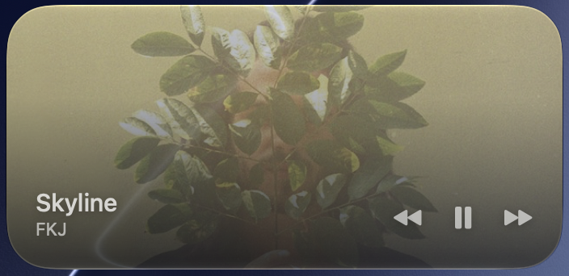
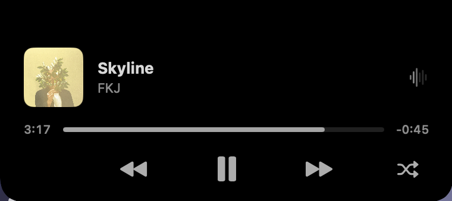
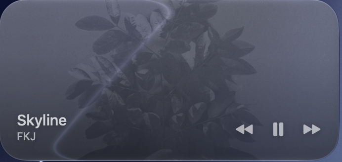
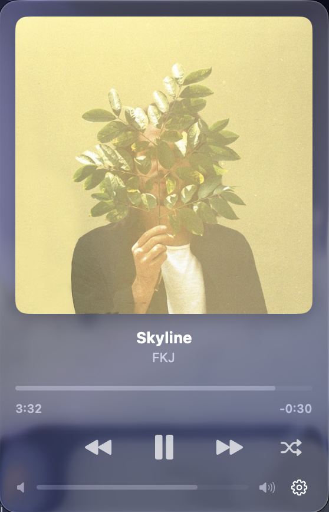
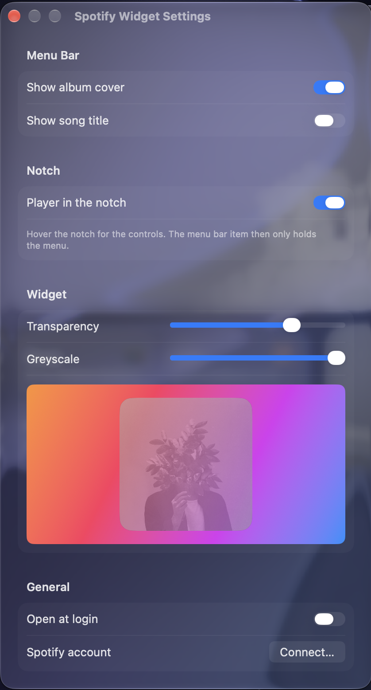

<div align="center">

# ◈ Spotify Widget

**A native macOS widget, menu bar player, and notch player for Spotify.**

Now-playing artwork as the backdrop, sliding track titles, playback controls, and Liked Songs: on your desktop, in your menu bar, or dropping out of your MacBook's notch.

[](#what-you-need)
[](#what-you-need)
[](#license)

<br>


&nbsp;


</div>

<br>

## What it is

Spotify Widget is a lightweight, menu-bar-only macOS app (no Dock icon) built with SwiftUI and WidgetKit. It drives Spotify's desktop app directly, so a widget can show what's playing on the desktop or in Notification Center. The same controls are available from the menu bar or the notch.

**[→ Jump to the install guide](#install)**

<br>

## Features

### 🎧 Desktop widget

The widget comes in small and medium sizes. The current track's artwork fills the background, long titles slide by, and the buttons skip and pause without opening anything. Click anywhere else on the widget to open Spotify.

Its look is yours to set: turn up **Transparency** to let your wallpaper through, or **Greyscale** to drain the color from the cover.

<div align="center">

&nbsp;

<br>
<sub>Full color (left) and with transparency and greyscale turned up (right)</sub>
</div>

### 🖥 Notch player

On a MacBook with a notch, rest the pointer on the notch and a player drops out of it: cover, title, a scrubber you can drag, and play/pause, skip, and shuffle. Move the pointer away and it tucks itself back in. While it's closed, it uses no resources.

<div align="center">

</div>

### 🪟 Menu bar player

On a Mac without a notch, or with the notch player turned off, the menu bar item opens a player instead: a large cover, a scrubber, the controls, shuffle, and volume. The gear opens Settings. The menu bar item itself can show the cover and the song title.

With the notch player on, the menu bar item becomes a plain menu (Settings, Reload Widget, Quit), so the controls aren't in two places.

<div align="center">

</div>

### ⚙️ Settings

Everything in one window: what the menu bar shows, notch or menu bar, the widget's transparency and greyscale with a live preview, Open at login, and the Spotify account for Liked Songs.

<div align="center">

</div>

### And also

- ❤️ **Liked Songs.** Save or remove the current track. Sign-in goes through Spotify itself (OAuth with PKCE), and the app never sees your password.
- 🔁 **Open at login**, with one toggle.
- 🪶 **Light.** No polling while Spotify is paused or closed, and nothing runs while the notch player is closed.

<br>

## What you need

| | |
|---|---|
| **A Mac** | macOS 14 (Sonoma) or later. The notch player needs a MacBook with a notch. |
| **Spotify** | The Spotify **desktop app**. The web player won't work. A free Spotify account is fine. |
| **Xcode** | Free from the Mac App Store. It's a big download (several GB), so start it first. |
| **An Apple ID** | The one you already use is fine. You **don't** need the paid Apple Developer Program. |

<br>

## Install

There's no download: an app that others can just open has to be notarized by Apple, and that needs a paid developer account. So you build it yourself with Xcode. It's mostly copy and paste, and takes about 15 minutes plus the Xcode download.

You'll type a few commands in **Terminal** (press ⌘Space, type *Terminal*, press Return). Copy each block, paste it into Terminal, and press Return.

### 1. Install Xcode

1. Install **[Xcode](https://apps.apple.com/app/xcode/id497799835)** from the Mac App Store.
2. Open it once. Accept the license, and let it install the extra components it asks for. You can close the "Welcome" window.

### 2. Sign in to Xcode with your Apple ID

1. In Xcode, open **Xcode → Settings…** (⌘,) and go to the **Accounts** tab.
2. Click **+** at the bottom left, choose **Apple ID**, and sign in. Your account appears with a team called *"Your Name (Personal Team)"*.
3. Select your account, click **Manage Certificates…**, click **+** at the bottom left, and choose **Apple Development**. Click **Done**.

   This creates the certificate that signs the app on your Mac.

### 3. Download the code

```sh
cd ~/Documents
git clone https://github.com/NilasMeeder/Spotify-Widget-MacOS.git
cd Spotify-Widget-MacOS
```

> Prefer not to use git? On the GitHub page, click **Code → Download ZIP**, unzip it into Documents, and run `cd ~/Documents/Spotify-Widget-MacOS-main` instead.

### 4. Tell the project your team ID

The widget and the app share data through an *App Group*, and macOS requires its name to start with your team ID. Look yours up:

```sh
security find-certificate -c "Apple Development" -p | openssl x509 -noout -subject
```

You'll see a line like this:

```
subject= /UID=…/CN=Apple Development: you@example.com (A1B2C3D4E5)/OU=XYZ9876543/O=Your Name/C=US
```

Your team ID is the 10 characters after **`OU=`**, here `XYZ9876543`. (The code in brackets after your email is something else.)

Now put it in the config file. Replace `XYZ9876543` with your own team ID:

```sh
cp Config/Local.xcconfig.example Config/Local.xcconfig
sed -i '' 's/YOUR_TEAM_ID/XYZ9876543/' Config/Local.xcconfig
```

This file stays on your Mac; git ignores it.

### 5. Build and install

```sh
xcodebuild -project SpotifyWidget.xcodeproj -scheme SpotifyWidget -configuration Release -derivedDataPath build -allowProvisioningUpdates build
```

This takes a minute or two. If macOS asks whether **codesign** may use a key from your keychain, enter your Mac password and click **Always Allow** (it may ask twice). Wait until it says `** BUILD SUCCEEDED **`, then:

```sh
ditto "build/Build/Products/Release/Spotify Widget.app" "/Applications/Spotify Widget.app"
rm -rf build
open "/Applications/Spotify Widget.app"
```

The app is now in your Applications folder.

<details>
<summary><b>Prefer Xcode's menus over Terminal for this step?</b></summary>
<br>

Run `open SpotifyWidget.xcodeproj`. In the bar at the top, pick the **SpotifyWidget** scheme and **My Mac**. Choose **Product → Archive**. When it's done, the Organizer opens: click **Distribute App → Custom → Copy App**, save it somewhere, and drag the `Spotify Widget.app` inside into Applications.

Don't use ⌘R for everyday use: it runs a debug copy from Xcode's own folder, and you'd end up with two Spotify Widgets.

</details>

### 6. First run

1. Open the **Spotify** desktop app and play something.
2. Spotify Widget has no window and no Dock icon. Look for its item in the **menu bar**, top right, showing the album cover. On a MacBook with a notch, rest the pointer on the notch.
3. macOS asks whether Spotify Widget may control **Spotify**. Click **Allow**. If you missed it: **System Settings → Privacy & Security → Automation → Spotify Widget → Spotify**.
4. Open **Settings** (from the menu bar item, or the gear in the player) to pick notch or menu bar, set the widget's look, and turn on **Open at login**.

> Don't see the menu bar item? On a MacBook with a full menu bar, it can hide behind the notch. Quit an app that puts icons up there, or hold ⌘ and drag other icons out of the way.

### 7. Add the widget

Right-click an empty spot on the desktop → **Edit Widgets…** → search for **Spotify Widget** → drag the small or medium size onto your desktop (or into Notification Center). Click **Done**.

<br>

## Liked Songs (optional)

The heart button saves the current track to your Liked Songs. That goes through Spotify's Web API, which needs a sign-in. Spotify only lets people in that an app's owner has added, so make your own (free) Spotify app for it:

1. Go to **[developer.spotify.com/dashboard](https://developer.spotify.com/dashboard)**, log in with your Spotify account, and click **Create app**.
2. Fill in any name and description. Under **Redirect URIs**, add exactly `spotifywidget://callback`. Under the APIs, tick **Web API**. Save.
3. Open the app's settings and copy its **Client ID**.
4. Add it to your config, with your own client ID in place of `abc123`:

   ```sh
   cd ~/Documents/Spotify-Widget-MacOS
   echo 'SPOTIFY_CLIENT_ID = abc123' >> Config/Local.xcconfig
   ```

5. Quit Spotify Widget and do [step 5](#5-build-and-install) again.
6. Choose **Settings → Spotify account → Connect…** and log in.

<br>

## Updating

Quit Spotify Widget (menu bar item → **Quit Spotify Widget**), then:

```sh
cd ~/Documents/Spotify-Widget-MacOS
git pull
```

and do [step 5](#5-build-and-install) again. Your settings and the widget on your desktop stay as they are.

## Uninstalling

Quit Spotify Widget, remove the widget from your desktop, and drag `/Applications/Spotify Widget.app` to the Bin. You can delete the `Spotify-Widget-MacOS` folder in Documents too.

<br>

## Troubleshooting

| Symptom | Fix |
|---|---|
| `xcodebuild` complains about the license or a missing tool | Open Xcode once and let it finish installing, or run `sudo xcodebuild -license accept` |
| `git` asks to install the command line developer tools | Install Xcode first (step 1), then try again |
| Build fails with a signing, certificate, or App Group error | Check that `Config/Local.xcconfig` exists and holds your team ID (step 4), and that you created the certificate (step 2) |
| Build says the bundle identifier is taken | Change `PRODUCT_BUNDLE_IDENTIFIER` in `project.yml` for both targets (the widget's must start with the app's), then run `brew install xcodegen` and `xcodegen generate` |
| Widget shows "Needs access" | Allow Automation: `System Settings → Privacy & Security → Automation → Spotify Widget → Spotify` |
| Widget shows "Spotify isn't open" | Open the Spotify desktop app |
| Widget is stuck | Menu bar → **Reload Widget**, or quit and reopen Spotify Widget |
| Widget is gone from the desktop and the widget gallery | Run `killall chronod` in Terminal; macOS reloads its widget list |
| Widget doesn't change after a rebuild | macOS keeps the old widget running. Run `pkill SpotifyWidgetExtension`; it restarts by itself |
| Two Spotify Widgets in the widget gallery | One is a debug build from pressing ⌘R in Xcode. In Xcode, choose **Product → Clean Build Folder** |
| No notch player | It only appears on a screen with a notch, with **Settings → Notch → Player in the notch** turned on |
| Liked Songs fails to connect | Use your own Spotify app's client ID, see [Liked Songs](#liked-songs-optional) |

<br>

## How it works

```
┌─────────────────────┐        AppleScript / Apple Events        ┌──────────────┐
│   Spotify Widget    │ ───────────────────────────────────────▶ │  Spotify.app │
│ (menu bar + notch)  │ ◀─────────────────────────────────────── └──────────────┘
└──────────┬──────────┘        now playing · play/pause/skip
           │
           │  App Group (shared container)
           ▼
┌────────────────────────┐
│ SpotifyWidgetExtension │   WidgetKit timeline → desktop / Notification Center
└────────────────────────┘
```

- The app listens to Spotify's playback notifications and checks in every 15 seconds while music plays. It writes a snapshot (track, artwork, position, liked state) to a shared **App Group** container.
- The widget reads that snapshot. It never talks to Spotify itself.
- Widget buttons run an `AppIntent`, which signals the app over a Darwin notification to send the command. Clicking elsewhere on the widget opens the app through a `spotify-widget://` link, and the app brings Spotify forward.
- The notch player is a borderless panel above the menu bar. A tracking area picks up the hover, so it needs no Accessibility permission.
- Liked Songs uses Spotify's Web API over OAuth PKCE, since AppleScript can't touch your library.

<br>

## Project layout

```
SpotifyWidget/                 Menu bar app
  SpotifyWidgetApp.swift         App entry point; menu bar item (popover or menu)
  MenuBarPopover.swift           The popover: cover, scrubber, controls, volume
  NotchPlayer.swift              The notch player
  SettingsView.swift             Settings window
  PlayerController.swift         Refreshing, commands, publishing to the widget
  SpotifyProvider.swift          AppleScript bridge to Spotify.app
  SpotifyAccount.swift           OAuth (PKCE) and Liked Songs via the Web API
  ArtworkCache.swift             Downloads and caches album art
  CommandListener.swift          Receives commands from the widget

SpotifyWidgetExtension/        WidgetKit extension
  NowPlayingWidget.swift         Widget configuration and timeline provider
  Intents.swift                  AppIntents for play/pause/skip/like
  Views/NowPlayingView.swift     Widget UI (small and medium)

Shared/                        Used by both
  NowPlaying.swift               Snapshot written to the App Group
  SharedStore.swift              App Group read/write helpers
  SharedViews.swift              SlidingText, LikeIconShape
  AppSettings.swift              Preferences shared with the widget
  PlayerCommand.swift            Commands sent from widget to app
  AppGroup.swift                 App Group identifier

Config/                        Build settings; your own go in Local.xcconfig
docs/images/                   Screenshots for this README
project.yml                    XcodeGen project definition
```

> The `.xcodeproj` is generated from [`project.yml`](project.yml) with [XcodeGen](https://github.com/yonaskolb/XcodeGen). After changing `project.yml` or adding files, run `brew install xcodegen` (once), then `xcodegen generate`.

<br>

## Credits

Spotify Widget was created by **[Kiran Prakash](https://github.com/geezkiran)**. The original project is at [geezkiran/Spotify-Widget-MacOS](https://github.com/geezkiran/Spotify-Widget-MacOS). It built the widget, the AppleScript bridge, and the Liked Songs sign-in.

This fork is maintained by **[Nilas Meeder](https://github.com/NilasMeeder)**. It adds the notch player, the menu bar popover, the settings window with the widget's look, and click-to-open.

<br>

## License

MIT, like the original project.

<br>

<div align="center">

Built with SwiftUI · WidgetKit · AppleScript · the Spotify Web API

</div>
